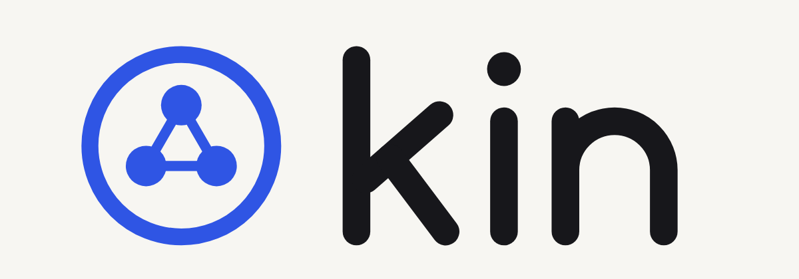
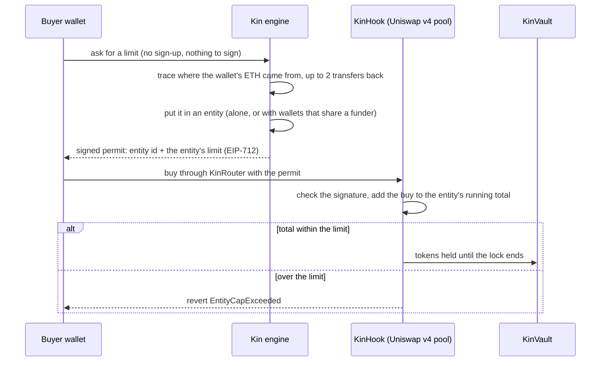

<p></p>

# Kin

**Fair token launches on Base. Kin limits people, not wallets.**

Wallets funded by the same source share one buy limit, and the pool itself enforces it through a Uniswap v4 hook.
Splitting money across ten wallets no longer buys ten times more.

- **Live site:** https://kin-flame-seven.vercel.app (launches run on Base Sepolia with test ETH)
- **How to test it:** [TEST.md](TEST.md), about 10 minutes, nothing to install
- **Source:** this repository (contracts, engine and site)

---

## Contents

1. [The problem](#the-problem)
2. [How Kin works](#how-kin-works)
3. [Who shares a limit](#who-shares-a-limit)
4. [What you can do on the site](#what-you-can-do-on-the-site)
5. [Architecture](#architecture)
6. [Deployed contracts (Base Sepolia)](#deployed-contracts-base-sepolia)
7. [Engine API](#engine-api)
8. [Trust model and limits](#trust-model-and-limits)
9. [Status](#status)
10. [Run it locally](#run-it-locally)
11. [Deploy your own](#deploy-your-own)
12. [Repository layout](#repository-layout)

---

## The problem

Token launches usually cap each wallet, or tax everyone who buys early. A per-wallet cap limits addresses, not
buyers: one person splits their money across ten fresh wallets and gets ten times the allowance. To the pool they
look like ten strangers. Taxing early buyers punishes everyone, including the honest ones.

Kin takes a narrower aim: leave ordinary buyers alone, and make the wallets that are secretly one person share one
limit.

## How Kin works



1. **A creator launches.** The factory deploys the token and a Uniswap v4 pool guarded by KinHook, with a buy window
   and a lock. The hash of the launch's rules file is stored onchain. The hook refuses settings outside its limits,
   including a minimum 30-minute review period before buying opens.
2. **A buyer asks for a limit.** Kin's engine looks at the wallet's funding history (transfers in, and transfers
   into its funders), leaving exchanges, bridges and Kin's own faucet out. If the wallet shares a funder with an
   earlier buyer, it joins that buyer's entity. The engine signs a permit for the entity and its limit, valid until
   the window closes. Every permit it hands out is public.
3. **The pool enforces it.** During the window the hook only accepts buys through KinRouter with a valid permit, and
   keeps one running total per entity. A buy that would take an entity past its limit reverts onchain with
   `EntityCapExceeded`.
4. **Lock, then open trading.** Window buys sit in KinVault until the lock ends, so nobody can buy at the capped
   price and dump a block later. After the window the pool works like any other pool.

The result: **one person gets one limit, however many wallets they use.** Three wallets or three hundred, a group
funded from the same place shares the same single allowance.

Launches run in one of two modes:

- **Instant** (default, what the site uses): no registration. The limit is decided when a wallet asks to buy.
- **Allowlist**: wallets register first; the entities go into a Merkle root and an evidence file whose hash is
  committed onchain before the window, and a wrongly linked wallet can dispute the link until the window opens.

## Who shares a limit

| Rule | Who | Their limit |
|---|---|---|
| Linked | A wallet funded by an earlier buyer, or by the same wallet as an earlier buyer, within two transfers | One limit for the whole group |
| New | A wallet with no history yet, or one funded more recently than the launch allows | One pool shared by every new wallet, so a farm of fresh wallets can't multiply its limit |
| Everyone else | No funding link to another buyer | Their own full limit |

Exchanges and bridges are left out of the trace on purpose, so two people who withdrew from the same exchange are
not linked. Kin's test-ETH faucet is treated the same way. Beyond the labelled list, any funder that is a contract or
has sent 10,000 or more transactions (an exchange hot wallet, a public faucet) counts as a public service and links
no one.

## What you can do on the site

| Page | What it does |
|---|---|
| **The flow** (`/flow`) | The whole mechanism, live. *Do it yourself*: one button creates three test wallets in your browser, funds them from Kin's faucet, splits the ETH like a bundler, asks Kin for limits and buys with all three in a real launch. A diagram fills in as each step happens, next to what a normal pool would have done with the same buys. *At scale*: one funder sends 20 wallets at a Kin pool and a normal pool at once. |
| **Launch a token** (`/launch/new`) | Name, symbol, limit per buyer, window and lock. One click deploys the token and its Kin pool on Base Sepolia and opens the launch page to share. Free; the engine pays the test gas. |
| **Launches** (`/launch`, `/launch/<slug>`) | Every launch: its phase, rules hash, limits, and a buy panel. Connect any wallet (or the built-in test wallet), get your limit, buy in the window, claim after the lock. |
| **Kin Scan** (`/scan`) | One search for any token. A Kin launch (by token address or name) shows every wallet that got a limit, which ones Kin counted as one buyer, and how much of each shared limit was used, read from the hook. Any other token on Base mainnet shows its early buyers grouped by shared funder and what Kin's limit would have refused. |
| **Profile** (`/me`) | Every launch a wallet has a limit in, its entity, what it bought, and a claim button once the lock ends. Also a "Get test ETH" button. |
| **How it works** (`/how-it-works`) | The mechanism with diagrams. |

The engine keeps a demo launch window open at all times: a new 3-hour window is deployed before the last one
closes, so there is always something to buy in.

## Architecture

```
            ┌──────────────────────── web/ (Next.js, Vercel) ────────────────────────┐
 browser ──▶│ /flow  /launch/new  /launch/[slug]  /scan  /me  /how-it-works          │
            └───────────┬───────────────────────────────────────────┬────────────────┘
                        │ HTTP (permits, launches, faucet, scan)    │ RPC (buys, reads)
            ┌───────────▼───────────── engine/ (Bun, Railway) ─┐    │
            │ funding tracer + cluster engine                  │    │
            │ permit signer (EIP-712)                          │    │
            │ launch service + public launches + demo keeper   │    │
            │ faucet, sandbox relayer, Kin Scan                │    │
            └───────────┬──────────────────────────────────────┘    │
                        │ createLaunch                              │
            ┌───────────▼──────────── contracts/ (Base Sepolia) ────▼────────────────┐
            │ KinLaunchFactory ─▶ token + Uniswap v4 pool with KinHook               │
            │ KinRouter (carries the permit) ─▶ KinHook (limit per entity)           │
            │ KinVault (holds window buys until the lock ends)                       │
            └────────────────────────────────────────────────────────────────────────┘
```

**Contracts** (`contracts/`, Foundry, Solidity)

- `KinHook`: a Uniswap v4 hook. Blocks swaps before the window; during the window accepts only KinRouter buys with
  a valid permit (or allowlist proof) and keeps `entitySpent[pool][entity]`; after the window it steps aside.
  Enforces deploy-time limits on the window, lock, review period and creator share.
- `KinRouter`: carries the permit into the swap and sends window buys to the vault.
- `KinVault`: holds window buys until `windowEnd + lockDuration`, then lets buyers claim.
- `KinLaunchFactory`: deploys the token and pool in one call and records the rules hash. A second factory
  deploys hookless "plain" pools with the same settings, used for the Kin vs normal pool comparisons.

**Engine** (`engine/`, Bun + TypeScript)

- `src/cluster/`: funding history (Alchemy or Blockscout) and the weighted cluster engine (same funder 1.0, shared
  funding source 0.8, same-block early buy 0.5, merge at 1.0, hub cap with a farm exception).
- `src/launch/instant.ts`: assigns a wallet to an entity at buy time and signs its permit.
- `src/launch/public.ts`: create and deploy a launch from the site (rate limited).
- `src/launch/demo.ts`: keeps a demo window open, each with a plain twin pool.
- `src/faucet.ts`: test ETH for visitors (one drip per wallet per day, four per IP).
- `src/sandbox/relayer.ts`: the 20-wallet attack on a Kin pool and a plain pool.
- `src/scan/`: Kin Scan for Base mainnet tokens, with the counterfactual of what Kin's limit would have refused.
- `src/server.ts`: the HTTP API.

**Web** (`web/`, Next.js App Router, wagmi + viem). A built-in test wallet connector lets anyone use the site
without a browser extension; keys stay in the browser and only ever hold test ETH.

## Deployed contracts (Base Sepolia)

| Contract | Address |
|---|---|
| KinHook | [`0x4Aec96A3CCAe1bb7C05dd56F98B2aE54FF8b00c0`](https://sepolia.basescan.org/address/0x4Aec96A3CCAe1bb7C05dd56F98B2aE54FF8b00c0) |
| KinRouter | [`0x335C69eE4CA9Ac603209c7bc06Bf321177577e90`](https://sepolia.basescan.org/address/0x335C69eE4CA9Ac603209c7bc06Bf321177577e90) |
| KinVault | [`0xdf20838644D6F1C8751DdF7Fba91DC09F96BaCe1`](https://sepolia.basescan.org/address/0xdf20838644D6F1C8751DdF7Fba91DC09F96BaCe1) |
| KinLaunchFactory | [`0xb37106d9B490905A0e93C1FC94a73A18737d5767`](https://sepolia.basescan.org/address/0xb37106d9B490905A0e93C1FC94a73A18737d5767) |
| Plain factory (no hook) | [`0xA54fb0bB8B7b9a5c476771271575Ea3b045d0141`](https://sepolia.basescan.org/address/0xA54fb0bB8B7b9a5c476771271575Ea3b045d0141) |
| Permit signer | [`0x5606da7e22630e960d75955Ce710622B322a9b16`](https://sepolia.basescan.org/address/0x5606da7e22630e960d75955Ce710622B322a9b16) |

Full deployment files: `contracts/deployments/84532.json` (launches) and `84532-sandbox.json` (sandbox).
Hook limits: window 5 minutes to 24 hours, lock up to 7 days, review period 30 minutes, creator share up to 10%.

## Engine API

| Method | Path | What it returns |
|---|---|---|
| GET | `/health` | Which features are on (scan, launches, faucet, sandbox, demo and public launches) |
| GET | `/launches` | Every launch, public view |
| POST | `/launches` | `{name, symbol, capEth, windowMin, lockMin, creator?}`: create and deploy a launch |
| GET | `/launches/:slug` | One launch |
| POST | `/launches/:slug/permit` | `{wallet}`: trace funding now, return the entity and a signed permit |
| GET | `/launches/:slug/permits` | Every limit handed out in the launch, with the funding transfers behind it |
| GET | `/launches/:slug/preview/:wallet` | The entity a wallet would get now (nothing saved) |
| GET | `/wallets/:wallet` | Every launch a wallet has a limit in |
| GET, POST | `/faucet` | Faucet status; `{wallet}` sends a drip of test ETH |
| POST | `/sandbox/runs` | Start a 20-wallet attack run |
| GET | `/sandbox/runs/:id/stream` | The run's events (server-sent events) |
| GET | `/sandbox/latest` | The latest finished run |
| GET | `/scan/:token` | Kin Scan of a Base mainnet token |

Allowlist-mode routes (register, allowlist, proofs, disputes, evidence) are listed at the top of
`engine/src/server.ts`.

## Trust model and limits

What is enforced onchain: the window, the lock, the review period, and each entity's limit. The limit is checked
inside the swap itself (the hook's `beforeSwap`), in the same transaction as the buy: a buy that would take an entity
over its limit reverts in the pool, whatever the website does, and there is no gap between the check and the buy
for a second wallet to slip through. Anyone can buy once the window opens; there is no allowlist or sign-up in
instant mode. The site fetches the buyer's permit (Kin's signed "this wallet belongs to entity X") a moment before
the buy, because a contract cannot read a wallet's funding history itself.

What you trust Kin's engine for: deciding who is linked. In instant mode the hook accepts any permit signed by the
launch's permit signer. That is why every permit is published with the transfers behind it, the rules file's hash
is stored onchain at deploy, and every window buy emits a `WindowBuy` event with the entity it was charged to. A
wrong assignment can be seen and audited, but it isn't blocked in advance. (Allowlist mode adds a dispute period
before the window instead.)

What Kin does not do, today:

- **Catch every bundler.** Wallets each funded from a different exchange or bridge look unrelated. Kin makes
  bundling cost more and makes it visible; it does not make it impossible.
- **Know who is a person.** A funding link is evidence, not identity: two friends paid by the same wallet share
  one limit.
- **Order buys inside the window, or limit trading after it.** Earlier buys get a better price, and once the window
  closes anyone can trade.
- **Run on Base mainnet.** Launches run on Base Sepolia with test ETH. Kin Scan reads Base mainnet.

## Status

| Piece | State |
|---|---|
| Contracts | 53 tests pass (`cd contracts && forge test`), 12 of them for instant-launch permits. Deployed to Base Sepolia (addresses above) |
| Engine | 61 tests pass (`cd engine && bun test`), including launch-backend and instant-launch integration tests on a local chain |
| Instant launches on Base Sepolia | Live. Demo launches are kept open around the clock; launches created from the site deploy in about 6 seconds |
| The flow, do it yourself | Verified end to end in a browser on Base Sepolia (9 Nov 2026, 42 s): 3 wallets funded from one, linked into one entity, each tried to buy the full 0.0001 ETH limit; 1 buy landed, 2 reverted with `EntityCapExceeded`, 0.0001 ETH recorded by the hook for the group. On a normal pool all 3 would land |
| The flow, at scale (sandbox) | Run on Base Sepolia (9 Nov 2026): every wallet tries to buy the group's whole limit; Kin pool 1 of 20 buys, plain pool 20 of 20. The refused buys revert with `EntityCapExceeded(entity, 0.00002 ETH cap, 0.00004 ETH attempted)` |
| Kin Scan for Kin launches | Live; reads the engine's public permits and the hook's `entitySpent` |
| Kin Scan for Base mainnet tokens | Verified on BRETT (9 Nov 2026): 50 early buyers, none sharing a funder once exchange hot wallets count as services; all 50 were new wallets. A first scan takes about 5 minutes on Alchemy's free plan (the engine backs off when rate limited) and is cached after |
| Fairness Receipt page + embed | Built |
| Replay (Kin's limits applied to past Clanker launches) | Built; **not yet computed**. No number in this repository describes real-world Base data until a job has computed it |
| Base Verify tier (verified-human limit) | Built and tested against a local mock; needs a Base Verify key to go live |

## Run it locally

Needs Foundry, Bun and Node.

```bash
git clone --recursive https://github.com/andrew1234-arch/kin && cd kin
(cd contracts && forge test)
(cd engine && bun install && bun test)
./engine/scripts/dev-local.sh      # anvil + contracts + engine API on :8787, seeded with demo launches
# in another shell:
cd web && npm install
NEXT_PUBLIC_KIN_API=http://127.0.0.1:8787 NEXT_PUBLIC_CHAIN_ID=31337 NEXT_PUBLIC_RPC_URL=http://127.0.0.1:8545 \
NEXT_PUBLIC_DEPLOYMENT_JSON="$(cat ../contracts/deployments/31337.json)" npm run dev
```

The 20-wallet attack on a local chain, in one command: `./engine/scripts/sandbox-local.sh`.

Against Base Sepolia instead (needs `DEPLOYER_PRIVATE_KEY` in `contracts/.env`):

```bash
./engine/scripts/serve-sepolia.sh   # engine on :8788: launches, demo keeper, public launches, faucet, sandbox, scan
```

## Deploy your own

1. **Contracts.** Fund a throwaway deployer with Base Sepolia ETH and deploy (see `contracts/README.md`). The
   deployer is also the permit signer unless you set one.
2. **Engine on Railway.** The repository has `railway.json` (builds `engine/Dockerfile`) and `.railwayignore`.
   ```bash
   railway login && railway init            # or railway link
   railway volume add --mount-path /data    # launches, permits and the faucet log live here
   ./engine/scripts/railway-env.sh          # copies DEPLOYER_PRIVATE_KEY, FAUCET_KEY and RPC URLs without printing them
   railway up && railway domain
   ```
   `engine/scripts/railway-start.sh` applies the same settings as `serve-sepolia.sh` and seeds an empty volume
   with the launches in `engine/seed/`. Fund the faucet address it prints with a little test ETH.
3. **Web on Vercel.** Set `NEXT_PUBLIC_KIN_API` (the engine URL), `NEXT_PUBLIC_CHAIN_ID=84532` and
   `NEXT_PUBLIC_DEPLOYMENT_JSON` (the contents of `contracts/deployments/84532.json`); RPC and explorer default to
   Base's public endpoints. See `web/.env.example`.
4. **Launches.** From the site's launch form, or the admin CLI:
   `bun run src/launch/admin.ts create-instant <slug> <name> <symbol> [capEth] …`.

Useful engine settings: `DEMO_LAUNCHES`, `PUBLIC_LAUNCHES`, `PUBLIC_LAUNCHES_PER_DAY` (20), `PUBLIC_LAUNCHES_PER_IP`
(3), `FAUCET_DRIP_ETH` (0.0005), `FAUCET_DAILY_DRIPS` (60), `SANDBOX_MAX_RUNS_PER_DAY` (12). All are documented at the
top of the file that reads them.

Real-network jobs, one command each (results land in `reports/`): `engine/scripts/real-mainnet.sh` (replay sample
and Gate A on Base mainnet) and `engine/scripts/real-sepolia.sh` (deploy if needed, Gate B, one sandbox run).

## Repository layout

```
contracts/    Foundry: KinHook, KinRouter, KinVault, KinLaunchFactory, tests, deploy and Gate B scripts
engine/       Bun + TypeScript: funding tracer, cluster engine, launch backend, faucet, sandbox relayer,
              Kin Scan, replay job, HTTP API (src/server.ts)
web/          Next.js: /, /flow, /launch, /launch/new, /launch/[slug], /scan, /me, /how-it-works,
              /receipt/[slug], /embed/receipt/[slug], /replay
TEST.md       how to test Kin, step by step
BUILD_LOG.md  what was built, with which AI tool, and what was changed by hand
SCORECARD.md  the Vibeathon 02 rubric, scored with evidence and open gaps
```
